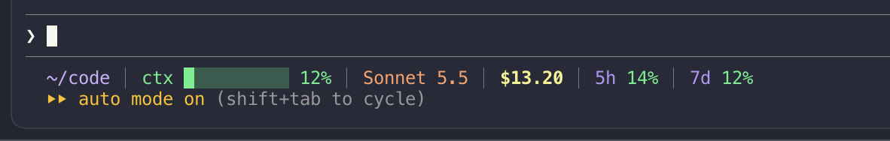

# agent-tools

Small personal add-ons for coding agents.

- `claude-code/` — Claude Code statusline and mods
- `pi/` — Pi extensions

# Claude Code

## claude-code/statusline/ (the taskbar)



`taskbar-statusline.py` is a `statusLine` command: cwd, context bar, model, git branch, PR link, session cost and 5h/7d rate limits.

```json
"statusLine": { "type": "command", "command": "python3 ~/.claude/taskbar-statusline.py" }
```
Copy the script to `~/.claude/` and add the setting above to `~/.claude/settings.json`.

## claude-code/mods/file-pane (the side pane)
A Claude Code mod that opens a right-hand pane Claude can put things in: files with pinned lines, git diffs, navigable directories, images, markdown, code and mermaid diagrams. Claude uses the `show` tool; you can use `/show`.

Install: copy `claude-code/mods/file-pane` into `~/.claude/mods/` and start Claude Code with
`CLAUDE_CODE_PLUGIN_DIRS=~/.claude/mods/file-pane`.

Notes
- Mermaid needs `npm i -g @mermaid-js/mermaid-cli`.
- Over SSH or in terminals that don't answer the graphics probe, set `CLAUDE_CODE_FORCE_TERMINAL_IMAGES=1`.
- JSX compiles to a global `h(...)`, so never name a variable `h` in a function that renders JSX.

## claude-code/mods/trajectory (`/trajectory`)
A concise overview of the session so far, modeled on the DeepSeek Harness trajectory view.

- **Overview tab:** goal, phases, key decisions with their reasons, open questions, loose ends and next steps. A model-written summary, built from the session's own cached transcript, capped so it stays short on long sessions. It is saved to `~/.claude/trajectories/<session>.json`, refreshed before a compaction, and carried forward so old decisions survive it.
- **Trace tab:** a three-lane timeline (Input, Model, Tools) over one line per event with role badges, `Turn N` markers, search, and an inspector on click. Built from the transcript by `scripts/ledger.py`, because a mod can't read a file over 4 MiB.
- **For the model:** `trajectory_get` and `trajectory_note` tools, so the agent can read the record after a compaction and log decisions as it makes them.

Install: copy `claude-code/mods/trajectory` into `~/.claude/mods/`, or into the session's `~/.claude/dev-mods/<session-id>/` folder to try it. Needs `python3`.

# Pi (`pi/extensions/`)
Copy into `~/.pi/agent/extensions/`.
- `taskbar.ts` — footer with cwd, tokens, cost, context meter, model and branch. `/cost-toggle` shows or hides it; `/pwd [dir]` shows or changes the working directory.
- `prompt-editor.ts` — dimmed `>` prompt in the empty editor.
